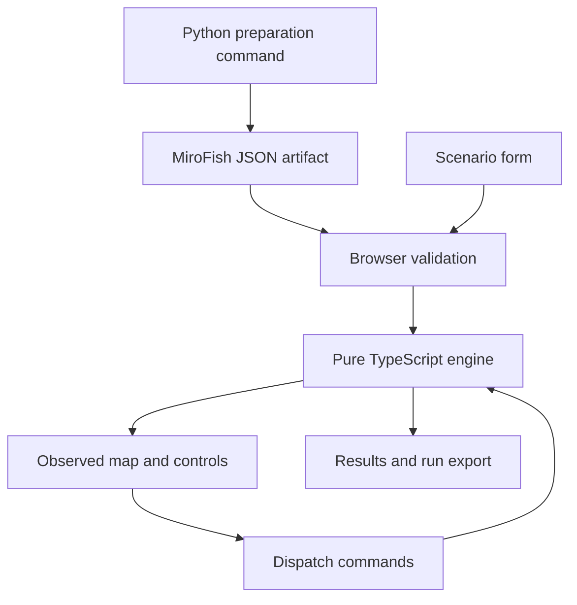

# Catastrophe Response Simulator: Standalone Master Plan

**Working document title only. A product name has not been selected.**

> **For implementation:** Treat this as a new, independent project. Use only the requirements identified as confirmed below. All architecture, interface, fixture, and staffing decisions are proposed implementation defaults, not preferences carried over from any other project. A single implementer can perform all tasks; optional parallel ownership is described in Section 14. This document is not evidence that the application or MiroFish integration has been executed.

**Goal:** Let users create catastrophe-response simulations, identify urgent and unreported needs, coordinate limited assistance, and inspect computed outcomes. The proposed hackathon demonstration uses a simple schematic map.

**Architecture:** One React/TypeScript browser application owns the simulation, controls, rendering, and results. A separate Python command reuses pinned MiroFish components during preparation and exports a small JSON artifact. The demonstration runs from local static files without a live model or application API.

**Tech stack:** React, TypeScript, Vite, native Canvas 2D, Vitest, Python 3.11 or 3.12, pinned MiroFish/OASIS dependencies, JSON files. Use Python unittest for the small adapter tests. No application database.

**Spec:** Sections 1–12 contain the proposed product and implementation specification. Sections 13–18 define tasks, scheduling, verification, release, and deferred work. This file supersedes the incorrectly branded catastrophe-response plan for this project only. It has no relationship to another project and assumes no shared name, codebase, assets, repository, visual style, or product requirements.

**Planning basis:** Corrected 8 November 2026, America/Chicago. The user specified a 24-hour hackathon and an architecture that is straightforward to finish. Twenty-four hours is the total event envelope, not an assumption that 24 hours remain. Rebase all schedules to the actual submission deadline.

**Evidence status:** The complete preceding master plan was reread for this correction. Its source findings refer to the previously inspected MiroFish commit 7657031ac01184afe2cb220f5ee3545573b5e843, not a new live execution or a claim about current main. This revision corrects project identity and inherited assumptions. No application, model credentials, integration, costs, performance, or scenario outcomes were tested as part of this document correction.

## Confirmed requirements

The user explicitly established that this is a new, independent project for the supplied State Farm catastrophe-response challenge. It must incorporate the specified MiroFish repository and let users create disaster-response simulations. It is a 24-hour hackathon project, so the architecture must be straightforward to complete.

No product name, visual theme, pixel-art direction, game format, team size, agent count, repository, provider account, spending limit, or judges-only deployment restriction has been confirmed for this project. Do not infer those choices from unrelated conversations.

## Proposed implementation defaults

The following choices are a scoped build proposal, not additional user requirements:

- One independent repository, a browser application, and a Python preparation command. No code, assets, or infrastructure from another project are assumed.
- A local browser demonstration using synthetic people and a fictional town, chosen to avoid hosting and real-person data dependencies.
- A readable schematic response map with forms and evidence cards. Visual branding remains undecided.
- One storm/outage family, one map, 24 households, at most three response units, and a 60-minute exercise.
- At most three MiroFish household representatives and one preparation-time social round for the first integration. Live society simulation is deferred.
- The engine owns needs, routes, supplies, shelter places, and assistance completion. The UI and baseline policy receive observations, not undiscovered truth.
- The creator, a complete discovery-to-assistance path, and accurate MiroFish provenance remain the core acceptance goals.
- A single implementer can own all six tasks. Optional parallel assignments are a scheduling aid, not a prerequisite.
- Preserve dependency notices and source attribution. Credentials must not enter frontend code, approved public artifacts, or submission recordings.

## Review focus

1. A creator change must not silently reuse an incompatible MiroFish episode.
2. A successful preparation process must not conceal rule-based fallback or a social round with no active agents.
3. A household communications outage must not accidentally prevent a responder assessment from reaching dispatch under the declared radio assumption.
4. Simultaneous commands, capacity contention, and the final simulation minute must preserve accounting.
5. Reset, replay, bad imports, and loss of internet must leave a usable, accurately labeled demonstration.

These conditions are assigned to concrete tasks and checks below.

## 1. Product decision and definition of done

The State Farm challenge asks for urgent-need identification, assistance coordination, and avoiding overlooked people during large disasters. Those are product-alignment objectives, not a verified scoring rubric. [S1]

The proposed user role is a response coordinator. A judge can use that role during the demonstration, but the product is not restricted to judges. The distinctive question is: **Who needs assistance but cannot appear in the incoming queue?**

The proposed complete demonstration lets a user:

1. Change supported incident and resource settings and start a new exercise.
2. See requests, public disruptions, and unassessed buildings.
3. Send a welfare check into a communications gap.
4. Discover a need and assign feasible assistance.
5. Observe arrival and completion.
6. Compare computed results with a transparent baseline.
7. Export and replay the run using the same initial conditions.

The interface has three screens: **Create**, **Respond**, and **Results**. No login, organization setup, administrator portal, or large chat interface is required.

### Release states

| State | Evidence required | Permitted description |
|---|---|---|
| Target release | Complete core flow; three verified LLM-generated MiroFish personas; a genuine autonomous social action; at least one validated request derived from that action | “Uses prepared MiroFish personas and social behavior in a catastrophe-response exercise.” |
| Reduced release | Complete core flow; genuine MiroFish persona generation verified; social run unavailable or invalid | “Uses MiroFish-generated personas; request behavior follows explicit rules.” |
| Integration blocked | No verified LLM-generated MiroFish profile, or only upstream rule-based fallback | Identify the exact failure. Do not claim the requested AI integration is finished. |

Recorded operation is the normal delivery mode. It is not evidence of reduced integration by itself. New response exercises can reuse compatible prepared behavior; a new AI population requires the preparation command.

The target is an inspectable decision exercise. Weather prediction, clinical triage, casualty forecasts, and operational emergency dispatch are outside its validated scope.

## 2. What the review changed

| Gap or excess in the previous plan | Decision in this master plan | Owning task |
|---|---|---|
| Unrelated branding and requirements contaminated the plan | Standalone identity; no inherited visual style, team size, credentials, budget, repository, or audience restriction | All tasks |
| Too many runtimes and synchronization boundaries | Browser simulation plus a preparation command; no live application API | T1, T2 |
| A game framework, worker transport, persistent database, and job management added scope | Native Canvas, main-thread pure functions, downloadable JSON | T1, T3, T5 |
| MiroFish output could be mistaken for successful model execution | Record actual LLM success, rule fallback, active agents, and autonomous actions separately | T2 |
| One-round run could have zero active agents at midnight | Explicit activity settings for simulated hour zero | T2 |
| Seeded posts could be mistaken for agent decisions | Exclude ManualAction initial posts from the autonomous-action gate | T2 |
| Scenario changes could invalidate prepared stories | Freeze three actor contexts and define an exact compatibility check | T1, T2 |
| Physical mechanisms exceeded the deadline | Fixed initial closures, preloaded kits, no mid-mission cancellation or evolving hazard | T3 |
| Assessment communication during an outage was ambiguous | Household networks can fail; response teams have reliable exercise radios | T3 |
| Event ordering and cutoff needed executable examples | Integer-minute rules and a golden household timeline | T3, T5 |
| Solvability had no concrete evidence | Require an executed default response script; label custom resource shortfalls | T1, T3 |
| First-use, import errors, reset, and laptop startup were incomplete | Explicit UI states, bounded import, clean replay, offline release test | T4–T6 |
| “24 hours” could be mistaken for remaining coding time | Complete the core early; rebase milestones to actual remaining time | T6 |

Complexity is removed by narrowing the supported exercise. Missing operational features do not become vague implementation obligations.

## 3. Proposed 24-hour build architecture

### 3.1 Demonstration runtime

Use a Vite React/TypeScript application. React renders forms, controls, evidence cards, and results. Native Canvas draws the schematic map and units. Canvas supports scripted 2D graphics; Vite provides React/TypeScript templates and static production output. [S8, S9]

The simulation is a set of pure TypeScript functions called on the browser main thread. At 24 households there is no demonstrated need for a worker. Measure before introducing one.

Use one controller for the authoritative state and clock. UI components receive an observation projection. Drawing and animation never change state.



During judging, only the local static server and browser must run. Python, Zep, and an internet connection are unnecessary for a compatible prepared exercise.

### 3.2 Explicitly excluded infrastructure

Do not add a Python HTTP service, FastAPI/Flask wrapper, authentication, cloud database, queue, websocket, container orchestration, multiple frontend packages, general plugin system, event-sourcing framework, or service worker.

Start this project independently with the smaller stack above. No existing project, framework, asset collection, or repository is assumed reusable. A game framework and a Web Worker are outside the proposed initial scope because neither is required by the defined map and engine.

Use one repository and one frontend package. The Python preparation utility is a tool in that repository, not a second product.

### 3.3 Proposed file ownership

| Path | Responsibility | Owner |
|---|---|---|
| src/model.ts | Shared types and version constants | Coordinator |
| src/scenario.ts | Scenario parsing, generation, structural validation | Coordinator |
| src/content/town-v1.ts | Fixed road graph, buildings, facilities, golden scenario | Coordinator |
| src/sim/engine.ts | Dispatch, minute advancement, mission milestones | Engine worker |
| src/sim/routes.ts | Deterministic shortest paths | Engine worker |
| src/sim/observe.ts | Public observation projection | Engine worker |
| src/sim/results.ts | Metrics, baseline, replay | Coordinator after engine interface freezes |
| src/App.tsx | Create/Respond/Results navigation and controller | UI worker |
| src/ui/Creator.tsx | Form and assumption summary | UI worker |
| src/ui/Response.tsx | Controls, inspector, accessible entity list | UI worker |
| src/ui/Results.tsx | Metrics and household timeline | UI worker |
| src/map.ts | Canvas drawing and hit testing | UI worker |
| src/styles.css | Compact visual system | UI worker |
| src/run-file.ts | Bounded JSON import/export | Coordinator |
| tools/prepare_mirofish.py | Actual upstream generation and one social round | MiroFish worker |
| tools/normalize_mirofish.py | Trace conversion and provenance | MiroFish worker |
| fixtures/actor-context-v1.json | Frozen inputs for three representatives | Coordinator |
| public/data/mirofish-v1.json | Validated prepared artifact | MiroFish worker |
| tests/*.test.ts, tools/tests/test_prepare.py | Focused verification | Component owner |
| README.md, UPSTREAM.md, THIRD_PARTY_NOTICES.md | Startup, evidence, attribution | Coordinator |

Keep original upstream source pinned under vendor/MiroFish or an equivalent immutable dependency checkout. Document small patches. Do not maintain a loosely copied, unversioned imitation of upstream behavior.

## 4. User-created scenarios

### 4.1 Creator contract

Every exercise uses storm-v1 and the same four-neighborhood map. All primary needs begin at minute zero. Three household representatives keep fixed initial facts; the other 21 households are generated deterministically.

| Field | Allowed values | Default |
|---|---|---|
| Seed | Integer 0 through 4,294,967,295 | 42 |
| Additional needs | Integer 0–9 among the other 21 households | 3 |
| Vans | 1 or 2; the first van is accessible | 2 |
| Crew supply kits | Integer 0–6, loaded before the exercise | 3 |
| Shelter A places | Integer 0–8; accessible powered shelter | 8 |
| Shelter B places | Integer 0–8; general powered shelter | 8 |
| Household communications gap | None, northwest, northeast, southwest, southeast | Southeast |
| Road layout | Open roads or one authored connected detour preset | Open roads |

The seed affects only ordinary-household generation and ordinary report timing. It never changes the three frozen MiroFish actors or their prepared request timing.

Instantiate the seeded generator only inside createScenario. The engine and baseline never draw randomness. Generate ordinary household sizes from 1–4, select the requested number of additional needs without replacement, and assign delivery or relocation with a declared 50/50 rule. Use a declared 50/50 urgent flag; urgent deadlines are minute 30 and other deadlines minute 60. Ordinary potential reports occur at a generated integer minute from 2–10. Freeze the generator version and a golden output fixture; replay uses the stored initial scenario.

For seed 42, the ordered ordinary-household candidate list begins H05, H12, H15; additional candidates follow the seeded order. Take the requested prefix, so increasing additional needs preserves existing cases. For this seed, H05 and H12 are nonurgent delivery needs and H15 is a nonurgent general relocation for four people. With the default three additional needs, the full fixture uses three kits and nine shelter places if all assistance completes. An executed response script, not those totals alone, establishes feasibility. Other seeds use the general generator.

Every field must change engine inputs. Cosmetic-only controls do not qualify as scenario creation.

Provide **Create exercise**, **Load default**, and **Import run**. Put resource details in a compact expandable section. A natural-language prompt, map editor, arbitrary incident upload, and arbitrary new disaster type are deferred.

### 4.2 Validation and feasibility

Reject malformed JSON, unsupported versions, unknown template IDs, non-finite values, out-of-range integers, duplicate IDs, dangling references, and unsupported keys.

The two authored road presets must keep every household, base, and shelter connected. A valid scenario may still have insufficient resources. Show a plain warning such as “Some transport needs may exceed available shelter places.” Never silently increase capacity or change the user's scenario.

The verified default must have an executed response script. All custom variants receive structural validation, not a guarantee that every need can be met.

Do not expose individual hidden needs in validation messages. A creator who chooses a need count already knows part of the scenario; do not characterize their run as a blinded evaluation.

### 4.3 Scenario editing and first use

Show a short assumption summary before starting: fictional town, household count, 60-minute duration, fixed initial outages/closures, preloaded kits, and prepared AI behavior.

Use the creator disclosure: “This creates a new response exercise using your conditions. Prepared MiroFish requests are reused where available; other reporting follows simulation rules.” Show the actual verified profile count and accepted social-request count in the provenance drawer. If only profiles were verified, use “MiroFish profiles; rule-based reporting.” Never hardcode a successful count. Show a verified-completion label only for the exact configuration with an executed witness; otherwise show “Custom conditions: completion feasibility unverified.”

The response screen starts paused. The first-use instruction is: “Select an unassessed home, choose a unit, and send a welfare check.”

Editing settings during a run starts a new run after an explicit reset control. It never mutates the current world in place.

## 5. Minimal world model

### 5.1 Population and facilities

There are 24 households, six per neighborhood, with 1–4 people each. Each household has at most one primary need: none, delivery, or relocation. Stable IDs persist across the run.

There are two powered shelters and one response base. The first van supports the authored accessibility requirement. The second van, when enabled, is general transport. Both have four seats. One response crew can assess and deliver supplies.

All households accept compatible assistance. No negotiation, autonomous evacuation, births/deaths, recovery progression, or additional need onset occurs during the exercise.

Needs are authored or generated exercise conditions. Personality, popularity, wealth, insurance status, and demographics never determine priority.

### 5.2 Three actions

| Action | Unit capability | Completion |
|---|---|---|
| ASSESS | Either van or crew | Travel to the household, then spend 2 minutes; publish the observed need or confirmed no current need |
| DELIVER | Crew only | Reserve one onboard kit; travel, then spend 2 minutes; consume the kit and resolve the need |
| RELOCATE | Compatible van | Travel, board for 2 minutes, travel to compatible shelter, unload for 2 minutes; resolve only at drop-off |

Road travel times are positive integer minutes. The map is schematic. Travel and service values are exercise assumptions, not empirical estimates.

Vehicles serve one household at a time. No multi-stop routes or split households. Units remain at the completed mission's destination and can accept another mission there.

### 5.3 Routes and precomputed milestones

Closures are fixed and public before the first command. Compute deterministic shortest paths with stable node-ID tie-breaking.

Because routes cannot change during a mission, calculate its path and milestone times when accepting it. Do not build an evolving route controller.

For a mission dispatched at minute t:

- Assessment or delivery completes at t + travel + 2.
- Relocation pickup completes at t + travel-to-household + 2.
- Relocation completes at pickup-time + travel-to-shelter + 2.

Zero-distance travel costs zero, but service still takes two minutes. For example, an assessment across a one-minute route completes after three minutes, not two.

Canvas animation interpolates along this recorded schedule. Animation timing cannot advance mission completion.

No cancellation or rerouting is required in the core. No dynamic road closure, unit breakdown, shelter failure, or supply replenishment occurs. At the horizon, an unfinished mission stays unfinished in the results.

### 5.4 Accounting

Assignment is atomic. Check unit availability, target knowledge, capability, route, household assignment, and required capacity before changing anything.

One active mission per unit and one active mission per household includes assessment. This prevents duplicate welfare checks as well as duplicate assistance.

Crew kits have available, reserved, and consumed counts. The sum equals the initial load. Reserve at dispatch and consume at delivery. No depot pickup or return logistics are modeled.

Shelter places have available, reserved, and occupied counts. Reserve the full household at dispatch. At drop-off, convert reserved places to occupancy and clear vehicle passengers.

A rejected command changes no resources. Repeating a command ID returns its previous result without applying it again. A command for an old run is rejected.

The same command ID with different action arguments is a conflict and changes nothing. Idempotent repeats are not appended a second time to the command log. Validate permission to know a target need before checking its private need type: attempting assistance for any unknown household returns the same public reason, “Assess or receive a request first.”

### 5.5 Clock and event ordering

Initialization constructs minute-zero truth, publishes public disruptions, and delivers any eligible minute-zero reports before the first view.

Dispatch is synchronous at the current integer minute and does not advance time. Commands at the same minute use monotonic sequence numbers.

advanceMinute moves from t to t+1:

1. Advance the clock exactly one minute.
2. Apply due pickup and completion milestones in mission-ID order.
3. Publish completed assessments through responder radio.
4. Attempt due household reports in report-ID order. Suppress a report if assistance already resolved its need.
5. Produce the next observation projection.
6. If the clock is 60, finalize results after those events.

Completion at a deadline is on time. Completion at minute 60 counts. Commands after finalization are rejected. A report delivered at minute 60 may establish discovery but cannot trigger a new mission.

The app supports pause, resume, one-minute step, and playback speeds. The default maps one simulated minute to two real seconds; faster playback is explicitly labeled. Opening an inspector pauses the clock. Browser visibility loss pauses the exercise. Do not catch up missed time after a stall.

An empty incoming queue never ends the exercise. Continue to the common minute-60 horizon or let the operator pause. Unknown households remain actionable when no visible requests remain.

### 5.6 Communication and information

Household requests use the selected neighborhood network. A potential request has one attempt; if the network is down, it remains undelivered. No retry or recovery system is needed for this exercise.

Response teams have reliable radios throughout the map. Their assessments reach dispatch on completion even inside the household communications gap. This is a declared modeling assumption.

Assessment observations set observedAt and receivedAt to the completion minute. They include the primary need or explicit no-need result, deadline/urgency, household size, accessibility requirement, and fixed consent. Those fields must be sufficient to enable a legal assistance command immediately, without a second contact action.

The dispatcher can see building locations, public outages, roads, unit positions, facility capacity, received requests, and completed assessments. It cannot see undiscovered needs, deadlines, private persona narratives, failed report contents, or truth-based totals.

Unknown and assessed-no-need are different states. Private request text and persona context become visible only when the relevant need is reported or assessed. All UI components, route previews, command errors, and baseline decisions consume the same public projection.

## 6. MiroFish integration that fits the deadline

### 6.1 Verified source findings

The inspected project is a social-simulation workflow built around OASIS. Its standard application validates Zep and LLM configuration. The narrower OasisProfileGenerator accepts supplied EntityNode inputs and can omit Zep enrichment. This is a plausible component seam, not proof of a working Zep-free installation. [S2–S5]

The standalone Reddit script accepts --config, --max-rounds, and --no-wait. It loads local profiles, uses a CAMEL model, initializes SQLite, applies initial ManualAction posts, then runs LLMAction rounds. It deletes an existing database at the chosen run path. [S6]

Two additional findings must affect implementation:

- The profile generator retries model generation and then silently uses its rule-based generator. A returned profile is insufficient proof of model success. [S5]
- Round zero uses simulated hour zero. Default activity hours can exclude all actors. A process can finish without generating an autonomous action. [S6]

The standalone trace and stock action-history endpoint do not have the same logging contract. Read the actual SQLite schema during the spike or use a small documented trace patch. Do not assume an API returns the required evidence. [S6, S7]

### 6.2 Preparation procedure and hard timebox

Allocate a maximum of 90 minutes to the initial integration spike. With optional parallel help, other tasks can proceed independently. With one implementer, complete this bounded spike and then continue the remaining tasks sequentially.

1. Install the pinned backend in an isolated Python 3.11/3.12 environment. Preserve its compatible dependency versions. Record the exact successful setup.
2. Supply the three frozen entities directly to the actual OasisProfileGenerator. Generate profiles sequentially and save with the upstream Reddit exporter.
3. Retain evidence of successful model calls and explicitly record any rule-based fallback. Preserve raw output separately from approved display text.
4. Use a unique work directory. Prepare one platform, one round, no initial seeded help posts, and explicit activity at hour zero.
5. Set all three agent activity levels to 1; include hour zero; set selection minimum and maximum to 3 and both activity multipliers to 1. These are preparation settings, not population realism claims.
6. Run the actual script with --max-rounds 1 --no-wait, or a documented thin adaptation. Ensure it exits and leaves no interview process.
7. Verify at least one successful help-related autonomous action attributable to an actor. Initial ManualAction posts, invented messages, and empty rounds do not pass.
8. Normalize accepted output into the JSON artifact. Run the TypeScript artifact validator and one engine observation test.

If the social run is not working at 90 minutes, stop expanding it. Keep verified profiles and deterministic reporting, and label the reduced integration. If profiles also fail, preserve the offline engine but record the MiroFish requirement as blocked.

Do not rebuild the entire upstream backend, add Zep, or change multiple model libraries late in the hackathon to rescue the integration.

### 6.3 Limits and secrets

Start with three profiles, one round, sequential profile preparation, and one controlled social process. Set explicit output and retry bounds through the actual supported call paths; document any upstream patch. A round cap is not an API-call or billing cap.

No provider credentials, account credit, or spending allowance are confirmed for this standalone project. Use only an authorized account and an explicitly configured preparation budget; verify pricing before making paid calls. Inspect usage after the first tiny run. Do not carry over a budget from another project, build a budget-reservation service, or claim a guaranteed billing ceiling.

A 180-second process timeout is an initial guard for the social command; terminate its child process tree on timeout. Bound profile calls separately. Record failures without printing secrets. Cancellation does not prove a provider stopped billing.

Credentials exist only in the preparation environment. The browser receives no API keys, provider clients, or private raw logs. The CLI refuses to overwrite a completed artifact unless a new output path is chosen.

### 6.4 Actor facts and compatibility

Freeze these representatives in actor-context-v1:

| Actor | Fixed household facts | Primary need |
|---|---|---|
| H02 | Two residents, fixed home node | One supply kit |
| H09 | Three residents, fixed home node, general transport compatible | Relocation |
| H19 | Two residents, fixed home node, accessible transport required | Relocation |

All three needs start at zero and are urgent with a deadline of minute 30. These are synthetic fixture facts. Other household needs and deadlines are generated separately.

Preparation sees these actor facts and the generic fact of a storm-related power outage. It must not receive fleet size, available kits, shelter capacities, household-network availability, road preset, other households, or future events.

A compatible response exercise can vary those omitted fields. The three actor contexts remain identical. The JSON artifact stores the complete preparation input hash, canonical actor-context digest, prompt/preparation version, upstream commit, model identifier, episode settings, actor mapping, allowed fact references, and timing-map version. The browser validates the frozen context and supported preparation contract against the selected template. The identity covers what was actually supplied to generation; an input cannot be declared irrelevant afterward.

Render live reports from canonical templates using the validated need and fact references. Keep raw social prose in a post-run provenance view labeled generated speech. Omit unsupported claims from live request cards. This avoids building a general natural-language fact checker. A generated persona's narrative is also post-run content; discovered-household cards show canonical known facts and a prepared display name.

Changing an actor's need, size, home, accessibility, deadline, or supplied public facts requires regeneration. No broad “similar enough” cache matching is allowed.

### 6.5 From social post to report

Only a successful autonomous help request linked to that actor's existing need can become a ReportCandidate. Preserve the source action ID and text. A small review/normalization step selects the candidate; it does not fabricate a post.

For the first version, append a fixed exercise instruction to the generated persona: an agent choosing to request help must put a small JSON object in its post content, with kind=help_request, its householdId, existing needId, and the complete allowed factRefs for that request. Preserve the original generated persona and the appended instruction in provenance. The normalizer parses this exact structure, verifies actor identity, and rejects missing or mismatched references. Referencing a fact explicitly authorizes its inclusion in the canonical exercise report. Do not infer unmentioned size, accessibility, or deadlines from prose and expose them as though the household supplied them. Unstructured posts remain social evidence only.

Use an authored mapping: first autonomous round maps to exercise minute 5. This is a demonstration assumption, not an estimate of human response time.

The engine reads the typed candidate and checks its actor, need, facts, and compatibility. At minute 5 it delivers only if the need is unresolved and the household network works.

When no valid social candidate exists for a fixed actor, its deterministic fallback report attempts at minute 10 and is labeled as such. A valid social candidate replaces that attempt with the authored round-mapped minute 5; it does not add a duplicate request. Non-representative households use their seeded report times. Test a real accepted candidate with an open channel: its arrival must change from 10 to 5 while the household's physical need remains identical. In an outage, either attempt can be dropped; do not claim every candidate changes every run's outcome.

## 7. Minimal interfaces

Use one set of TypeScript types. Python writes the interchange format and is checked against the same golden JSON fixture. Do not maintain a second framework-generated schema.

| Type | Required content |
|---|---|
| ScenarioConfig | Version, template, seed, additional needs, vans, kits, shelter places, network gap, road preset |
| Scenario | Complete generated truth, public map/resources, fixed potential reports, generation version |
| SimState | Run ID, minute, households, units, missions, resources, received observations, processed command IDs |
| ObservationView | Public locations/resources, permitted household facts, public unit routes, known request queue |
| Command | Run ID, command ID, sequence, current minute, action, unit ID, household ID, optional shelter ID |
| CommandResult | Accepted/rejected, public reason, optional mission ID |
| ReportCandidate | Source action ID, actor/household ID, existing need ID, allowed fact references, attempt minute, provenance outcome |
| AgentArtifact | Version, source commit, model, generation outcome, three actor contexts, accepted candidates, provenance references |
| RunFile | File kind/version, source run ID, config, complete initial scenario, embedded approved artifact, ordered commands, saved minute, expected replay summary |

Proposed function signatures:

```ts
parseConfig(input: unknown): ScenarioConfig
validateArtifact(input: unknown): AgentArtifact
createScenario(config: ScenarioConfig, artifact: AgentArtifact | null): Scenario
initialize(scenario: Scenario, runId: string): SimState
dispatch(state: SimState, command: Command): { state: SimState; result: CommandResult }
advanceMinute(state: SimState): SimState
observe(state: SimState): ObservationView
shortestPath(map: RoadGraph, from: string, to: string): Route | null
summarize(state: SimState): RunSummary
chooseBaseline(view: ObservationView): CommandIntent[]
replay(file: RunFile): SimState
```

CommandIntent contains action, unit ID, household ID, and optional shelter ID. The controller supplies run identity, minute, command ID, and sequence. RunSummary contains the metrics defined in Section 9 and per-household timestamps. RoadGraph and Route use stable node IDs, positive integer edge minutes, and ordered route legs.

No replay snapshots, general branch identities, async model proposals, or revision-based job protocol is necessary. The complete 60-minute run is small enough to rebuild from its initial scenario and command log, subject to verification.

## 8. Schematic interface and interaction states

No visual theme has been selected for this project. The proposed implementation uses a readable schematic map with simple building, road, vehicle, crew, and shelter symbols drawn directly in Canvas. Use consistent spacing, legible HTML text, and distinguishable operational states. Pixel art, a cyberpunk appearance, a dark theme, and a game-like presentation are not requirements. Avoid an asset-production pipeline in the core build.

As an implementation default, test at 1366 × 768 and 100% browser zoom with a map beside a collapsible inspector and a small unit strip. No exact map ratio, compact-UI preference, or presentation hardware is confirmed. Choose dimensions for readable controls and evidence. Check the actual demonstration display and scaling during rehearsal.

No pan/zoom or mobile layout is required. Fit the whole authored town. All labels and controls are HTML text; Canvas carries the world picture. Provide an HTML household/unit list for keyboard access and a second path to selection.

Use icons or patterns as well as color: unknown, reported, assessed-no-need, assigned, and assisted. The selected entity and route must remain identifiable in reduced motion.

| Situation | Required behavior |
|---|---|
| Initial launch | Default creator opens with no network dependency |
| Start | Response map opens paused with one short instruction |
| Select entity | Open inspector and pause; show only permitted evidence |
| Newly discovered urgent need | Auto-pause and provide a Review need action using the new observation |
| Illegal action | Explain the public constraint; change no state |
| Busy unit | Show destination and completion estimate; disable incompatible dispatch |
| No kits or shelter space | Keep the exercise usable and show the exact available capacity |
| Invalid AI artifact | Disable the artifact and use labeled deterministic behavior |
| Invalid run import | Leave the current run unchanged and show a readable error |
| Tab hidden | Pause, with explicit resume on return |
| Reset | Start a clean run with new run ID and cleared selections/timer |
| Minute 60 | Stop dispatch and show results; reveal truth only in debrief |

The assignment control shows destination, ETA, reserved resources, and “Unit committed until completion.” Keyboard controls include visible focus, Enter activation, Escape to close the inspector, and a labeled pause control. Canvas uses generous hit regions and the HTML list selects the same entities. The resource and dispatch UI is the central interaction. Add no chatbot to the core.

## 9. Comparison and outcome accounting

The primary comparison is the user's completed run against one deterministic baseline.

The baseline receives observe(state), not truth. It handles known urgent needs by earliest deadline; breaks ties by projected completion time then household ID; and chooses compatible resources. An otherwise idle unit assesses the nearest uncontacted household, breaking ties by household ID. Only when none remain does it assess a reported but unassessed household. It does not repeatedly inspect a known case while other homes remain outside contact.

At each integer minute before advancing, the baseline can dispatch all idle units in stable unit-ID order. After each accepted assignment, recompute the public view before assigning another unit. This prevents policies from racing for the same final shelter places or household. Manual play permits the same multiple-command opportunity while paused. Skip households with any active mission. The baseline can act immediately on an assessment received at minute 8.

Both runs use the identical fully generated initial scenario and potential request schedule. Clone the scenario before either run; do not mutate a shared object. Discovery and report suppression are recomputed within each run.

| Metric | Definition |
|---|---|
| Contact coverage | Households with a delivered request or completed assessment / 24 |
| Assessment coverage | Households assessed / 24 |
| Timely urgent assistance | Urgent needs completed at or before their deadline / all urgent needs |
| Unmet urgent-need minutes | Sum of min(completion time or 60, 60) minus onset, for urgent needs |
| Still undiscovered | Needs that never became known by minute 60 |
| Assistance completed | Number of primary needs actually resolved |
| Resource use | Kits consumed, shelter occupancy, unit busy time |

All onsets are zero in this version. A need completed at minute 24 contributes 24 unmet minutes. A need unresolved at the horizon contributes 60. A relocation still onboard at minute 60 is unresolved. Keep its passengers and reservations accounted for in the final snapshot; do not refund or complete them artificially. Show “N/A” for a rate with no denominator.

Only public coverage and known queue/resource counts appear live. True need totals and hidden need details appear after the run.

The comparison must show losses and ties honestly. Report improvements in this exercise; do not attribute a policy improvement to the LLM without an isolated experiment.

## 10. Save, replay, failures, and scope limits

Export a JSON RunFile from a paused or completed run. Include the complete initial scenario and approved prepared artifact, not only a seed or a remote artifact URL. Record both accepted and rejected commands with their outcomes; replay invokes the same dispatcher in sequence.

Store each unique command ID once, with strictly increasing sequence numbers and nondecreasing minute values. Validate all recorded command run IDs against the file's source run ID. Replay allocates a fresh runtime ID and remaps only that validated field before dispatch; command IDs, order, arguments, and expected outcomes remain unchanged.

A saved partial run replays to its saved minute and opens paused. A replay must reproduce the same deterministic summary after excluding run ID and wall-clock metadata. Do not make provider calls during replay.

“Replay run” reproduces saved decisions. “Restart same conditions” reuses the materialized initial scenario and artifact with a fresh run ID and empty command log. “Edit conditions” returns to the creator and generates a new scenario. These are distinct controls; none silently reruns MiroFish.

Keep import to 1 MiB and at most 500 commands for the 24-household fixture. Reject other file kinds, unsupported versions, out-of-order or out-of-range command times, bad references, oversized text, and inconsistent actor-context digests. Parse into a temporary object and validate before replacing current state.

The controller stops accepting new unique commands at 500, displays the limit, and still permits clock advancement, export, and reset. This keeps the application's own export within its import contract.

Regenerate the supported initial scenario from the imported config and approved artifact and compare it with the stored initial scenario. Reject a mismatch rather than accepting arbitrary edited world truth. A controller generation counter prevents a completed asynchronous file read from installing after reset, a newer import, or navigation to another run. There is no automatic schema migration in the hackathon build.

Render imported and model-generated strings as text, not HTML. No executable content, remote URLs, or external resource loading is accepted in a run file.

Use downloaded JSON rather than IndexedDB. The core does not promise automatic crash recovery. The interface states that unsaved runs reset on reload and provides an obvious export button. A bundled default run supports recovery during judging.

## 11. Golden exercise and evidence

The default map must satisfy these authored distances:

- Response base to H19: 6 minutes.
- H19 to accessible Shelter A: 6 minutes.
- The applicable vehicle and crew use the same edge-time rules.

The crew and accessible van V1 start at the response base. V1 remains idle through minute 8; any earlier visible-request assignment in the demonstration uses V2. Shelter A has at least two unreserved compatible places when V1 is assigned. The full demonstration command sequence, including V2's work, is part of the witness test.

The golden engine-test sequence uses an explicitly synthetic H19 candidate at minute 5 to exercise the report hook. It is test data and must never be labeled a real MiroFish output:

| Minute | Event | Required state |
|---|---|---|
| 0 | H19 has an urgent relocation need; its network is down | Unknown to dispatcher |
| 0 | Crew dispatched to assess H19 | Crew busy; no urgency leak |
| 5 | H19 potential request attempts delivery | Undelivered, contents hidden |
| 8 | Assessment completes over responder radio | Need becomes known |
| 8 | Accessible van dispatched; two Shelter A places reserved | Assigned, not assisted |
| 16 | Household boards | Two passengers; need unresolved |
| 24 | Shelter drop-off completes | Need resolved; two occupied places; no passengers |
| 30 | Deadline | Completion at 24 is timely |

These are required fixture expectations, not measurements from an implemented app.

The actual demonstration uses the approved real artifact and records its actual attempt times. If H19 has no accepted social candidate, its rule-based attempt is at minute 10; the assessment at 8 and relocation at 24 still follow the same mission schedule. Update the demo's evidence captions accordingly. Do not edit a model trace to force the test fixture's narrative.

Also execute a full default response script through minute 60 to establish which needs can be met under its chosen parameters. Do not label the default “verified” until that check passes.

## 12. Data, realism, and cost boundaries

Use fictional households and an authored map. No external data ingestion is required to demonstrate the mechanism.

HHS emPOWER and CDC/ATSDR SVI support later aggregate scenario design. They do not identify individual fictional residents' conditions. FEMA's shelter definition supports representing accessibility, finite places, and infrastructure. [S10–S12]

The exercise models travel, scarce resources, incomplete observations, and time pressure. It does not simulate storm physics, injury progression, or empirically calibrated human behavior.

MiroFish is AGPL-3.0. Preserve its license, notices, exact source revision, and changes; provide the corresponding source appropriate to distribution. Use an openly attributable project structure rather than assuming a process boundary removes license obligations. [S13]

The current competition's reuse rules and required submission fields remain an organizer-verification item. Do not substitute rules from a different HackUTD event.

## 13. Build tasks with concrete gates

All commands below are scripts to implement or existing upstream commands to verify during development. None has been executed by this planning task.

### T1. Freeze the fixture and launch the shell

**Owner:** Coordinator. **Files:** model.ts, scenario.ts, town-v1.ts, actor-context-v1.json, package files, tests/scenario.test.ts.

**Consumes:** Sections 4, 5, and 7. **Produces:** ScenarioConfig, Scenario, AgentArtifact contract, createScenario, shared fixture.

- [ ] Create one React/TypeScript/Vite project and pin the successfully installed dependency versions in the lockfile.
- [ ] Define the exact shared interfaces and a valid artifact example clearly marked synthetic fixture, not real MiroFish evidence.
- [ ] Add bounds tests: seed -1 fails, kits 7 fails, vans 0 fails, missing household reference fails.
- [ ] Assert both road presets are connected and the golden default distances equal 6 and 6.
- [ ] Assert the same seed and inputs produce identical truth and ordinary report schedules, independent of run ID.
- [ ] Run npm run typecheck and npm run build; both exit successfully.
- [ ] Commit the foundation before parallel workers change application files.

**Gate:** A valid scenario is generated, invalid inputs fail, and the app shell builds. Workers receive the same fixture and interfaces.

### T2. Produce a genuine MiroFish artifact

**Owner:** MiroFish worker. **Files:** preparation/normalization tools, their unittest file, public/data/mirofish-v1.json, UPSTREAM.md.

**Consumes:** actor-context-v1.json and AgentArtifact contract. **Produces:** Validated artifact, raw evidence in a private work directory, integration-level record.

- [ ] Execute the 90-minute procedure in Section 6 using the pinned upstream source.
- [ ] Record whether each profile used a real model response or upstream rule fallback.
- [ ] Verify all three agents are active in round zero; record the actual count.
- [ ] Prove a retained help post was produced by an autonomous LLMAction, not an initial ManualAction.
- [ ] Normalize actor IDs and candidate facts without adding facts to the world.
- [ ] Assert a candidate changes report arrival only, and an incompatible actor context is rejected.
- [ ] Run python -m unittest discover -s tools/tests and npm run test:pack successfully.
- [ ] Commit only approved synthetic artifacts, notices, and code. Keep keys and raw credential-bearing logs out.

**Gate:** Actual evidence establishes target or reduced integration. A mocked JSON file or successful exit status alone is insufficient.

### T3. Complete the offline response engine

**Owner:** Engine worker. **Files:** engine.ts, routes.ts, observe.ts, tests/engine.test.ts.

**Consumes:** Scenario and Command. **Produces:** initialize, dispatch, advanceMinute, observe, shortestPath.

- [ ] Implement deterministic routes and precomputed mission milestone times.
- [ ] Implement atomic ASSESS, DELIVER, and RELOCATE commands.
- [ ] Assert repeated command IDs do not consume resources twice and old run IDs cannot alter state.
- [ ] Assert two simultaneous requests cannot claim the final shelter places.
- [ ] Execute the H19 timeline exactly: unknown before 8, pickup 16, completion 24, unmet minutes 24.
- [ ] Assert kit conservation, shelter conservation, and one active mission per household/unit.
- [ ] Assert same-minute completion suppresses a later-due report and minute-60 completion counts.
- [ ] Assert a one-minute route plus two-minute service completes at minute 3, and zero-distance service still takes two minutes.
- [ ] Assert two different hidden needs behind the same ObservationView produce identical legal-action results and baseline decisions.
- [ ] Run npm run test:engine successfully and return an integration commit.

**Gate:** A complete discovery-to-assistance path works without AI or graphics and exposes no hidden need through observe.

### T4. Wire the three-screen interface

**Owner:** UI worker. **Files:** App.tsx, ui components, map.ts, styles.css.

**Consumes:** ObservationView, CommandResult, shared fixture. **Produces:** Creator, response workflow, results shell.

- [ ] Build the creator with the exact supported fields and assumption summary.
- [ ] Draw the town and unit positions from the public view.
- [ ] Wire selection, HTML entity list, assessment, delivery, relocation, pause, step, speed, and reset.
- [ ] Show reservations and milestone times; never label dispatch as completion.
- [ ] Verify select pauses and repeated play/reset does not create multiple timers.
- [ ] Verify newly discovered urgency auto-pauses at minute 8, so the operator can dispatch at that same minute.
- [ ] Verify 1366 × 768 layout, keyboard selection, readable text, and status shapes as well as colors.
- [ ] Complete one manual browser exercise against the real engine.

**Gate:** A first-time operator can create and complete a run. Placeholder controls and hidden-truth imports are absent.

### T5. Add results, baseline, export, and replay

**Owner:** Coordinator after the engine interface stabilizes. **Files:** results.ts, run-file.ts, Results.tsx coordinated with UI owner, tests/results.test.ts, tests/run-file.test.ts.

**Consumes:** Initial Scenario, command log, SimState, ObservationView. **Produces:** summarize, chooseBaseline, replay, bounded import/export.

- [ ] Calculate every displayed outcome from engine timestamps and accounting.
- [ ] Implement one baseline using public observations and stable tie-breaking.
- [ ] Assert cloned paired scenarios do not share mutable state and endogenous discovery is recomputed.
- [ ] Verify a tie or baseline-win case; no fixed improvement percentage exists.
- [ ] Export/import a partial and completed run; assert replay equality and zero provider calls.
- [ ] Save at minute 17, reload paused with providers unavailable, and reproduce the same state and minute-60 results.
- [ ] Reject invalid files without replacing the current run.
- [ ] Run npm run test:results and npm run test:run-file successfully.

**Gate:** Results, comparison, and replay are calculated and reproducible.

### T6. Freeze and package the demo

**Owner:** Coordinator and an independent reviewer in a freed worker slot. **Files:** README, attribution, build-status, demo material.

**Consumes:** Integrated application and evidence from T1–T5. **Produces:** Launchable local build and truthful submission material.

- [ ] Run typecheck, focused tests, and production build from the final commit.
- [ ] Start the built application and complete a default exercise with internet disabled.
- [ ] Import a saved run, reset, and repeat the silent-household path.
- [ ] Independently review observation leakage, resource accounting, actor compatibility, and provenance.
- [ ] Verify a clean checkout can launch on the presentation laptop using documented commands.
- [ ] Record the three-minute demo and retain the exact seed, run file, commit, and build.
- [ ] Check organizer rules, required links, attribution, and submission completeness before the actual deadline.

**Gate:** Every advertised feature is demonstrated. Record unresolved limitations instead of marking unexecuted checks as passed.

## 14. Parallel ownership and integration discipline

Team size and coding-agent use are not confirmed requirements. The owner labels in Section 13 are responsibilities that one implementer can perform. The default sequential order is T1, the bounded T2 spike, T3, T4, T5, and T6.

If parallel coding is available and authorized, use up to three workers for independent engine, UI, and MiroFish tasks rather than competing full implementations. A coordinator then owns shared types, package manifests, dependency lockfiles, and scenario content. Parallelism is an optional execution method, not a dependency or an inherited user preference.

The UI worker can initially use the shared synthetic fixture, but it must be replaced by the actual engine before the UI gate passes. The engine worker never waits for MiroFish. The MiroFish worker never changes the engine to accommodate unvalidated prose.

Use isolated worktrees if already available and cheap to establish. Otherwise enforce exclusive file ownership in the shared repository. A worker returns changed paths, a commit or patch, verification evidence, contract changes, and remaining blockers.

With parallel work enabled, integrate runnable increments every 60–90 minutes and resolve contract changes centrally. A freed worker can independently review another component. Cap that optional arrangement at three active workers. With a single implementer, use the same acceptance gates and perform a separate review pass; do not claim independent review occurred unless another reviewer actually participated.

## 15. Deadline-aware schedule and cuts

At kickoff, record the actual current time, submission cutoff, and remaining wall-clock budget. Confirm the event's initial-entry and final-entry requirements separately. The previous research's countdown must not be reused.

Target a complete core within approximately eight productive hours. This is a planning target, not a measured delivery promise.

| Elapsed effort in a full 24-hour envelope | Deliverable |
|---|---|
| 0–1 hour | T1 contract/shell; T2 can start in parallel only when another implementer is available |
| 1–4 hours | Bounded MiroFish spike and the first engine/UI slice; independent work may overlap when available |
| 4–7 hours | Creator-to-engine integration, silent-household path, computed results |
| 7–8 hours | Baseline, replay, offline launch; core feature freeze |
| 8–12 hours | Fix gaps and improve map readability; optional scale evidence only after core gates |
| 12–16 hours | Independent review, actual-laptop checks, clean-launch instructions |
| 16–20 hours | Protected contingency and personal needs/rest; no assumed extra feature capacity |
| 20–22 hours | Final build, recording, submission materials |
| 22–24 hours | Submission verification and contingency; no new features |

Do not treat these rows as permission to miss an earlier organizer deadline. If less time remains, preserve at least the final two hours for verification and submission and compress to the core.

Hard cut points:

- At 90 minutes of MiroFish effort, select the verified integration level and stop expanding the dependency problem.
- If the end-to-end path is absent by hour 4, cut all visual embellishment and optional exports beyond the run JSON.
- If the core is incomplete by hour 8, stop feature work and finish the existing flow.
- Never cut truth separation, resource accounting, scenario creation, or honest provenance to add a feature.
- If only a reduced prototype is deliverable, state that explicitly. A planned feature is not a shipped feature.

## 16. Three-minute demonstration and launch package

### Demonstration

| Time | Action | Evidence |
|---|---|---|
| 0:00–0:25 | Change network gap and resource settings; start paused | User-created response exercise |
| 0:25–0:50 | Show visible requests and unassessed neighborhood | Missing requests do not establish safety |
| 0:50–1:20 | Dispatch welfare check and assistance elsewhere | Discovery competes for scarce units |
| 1:20–1:50 | Reveal H19, show permitted prepared context, assign compatible transport | Grounded need and actual allocation |
| 1:50–2:15 | Advance through boarding and drop-off | Capacity and completion accounting |
| 2:15–3:00 | Compare results and inspect the household timeline | Computed, traceable consequences |

If the demonstrator uses a saved run, say so. Use measured values from the executed run. Do not prewrite an improvement percentage.

### Startup contract

Document a tested compatible Node version. Check the selected Vite version's official requirements and pin a tested compatible runtime rather than upgrading during judging. [S9]

The intended frontend commands are npm ci, npm run build, and npm run demo. Define demo as a local production preview on 127.0.0.1:4173 with a strict port. This is a laptop demonstration, not a production hosting claim.

The preparation command is run separately in its verified Python environment:
```text
python tools/prepare_mirofish.py --input fixtures/actor-context-v1.json --output public/data/mirofish-v1.json
```

The wrapper creates unique private work directories internally. The README must explain the tested Windows interpreter/venv command if preparation is performed on the presentation laptop. Preparation is not required to replay the bundled demo.

Keep fonts, assets, and approved data local. Retain a built distribution, saved run JSON, three-minute video, source link, dependency notices, and one-page description. Test offline loading from the local server; opening an HTML file directly is not the supported launch method.

## 17. Deferred work and honest scale claims

After the core passes, a maximum one-hour stretch task may generate a headless fixture containing at least 1,000 residents. Record residents, households, model representatives, elapsed runtime, and whether any UI was exercised.

Do not call a headless benchmark a tested large-population interface. Do not equate residents with LLM agents. If the benchmark is unfinished, present the 24-household prototype and the intended scaling direction.

Everything below is outside the hackathon core: live bidirectional MiroFish/world coupling; live chat; prompt-based creation; full Zep graph workflow; arbitrary geography; new hazard physics; dynamic roads and infrastructure repair; multiplayer; authentication; production hosting; general branching; autonomous evacuation; misinformation; empirically calibrated behavior.

Those features need additional state and evidence. They are not hidden requirements for the first release.

## 18. Final coverage and unresolved evidence

**Project identity:** Standalone catastrophe-response simulator. The descriptive title is temporary. There is no inherited branding or design relationship to another project. This corrected specification supersedes the misidentified catastrophe-response document, not any separate project's files.

| Requirement or proposed scope | Covered by | Completion evidence |
|---|---|---|
| Create simulations | Creator, schema, seeded ordinary population, configurable resources/disruptions | Two different user configurations produce different valid initial states |
| Incorporate MiroFish | Actual generator, social runner, trace normalization, source attribution | Real retained output and accurately labeled integration level |
| Identify urgent needs | Requests and radio-delivered assessments | Hidden H19 need becomes known only at permitted observation |
| Coordinate assistance | Unit capabilities, travel, atomic capacity reservations | Golden pickup/drop-off timeline and conservation tests |
| Avoid overlooking people | Unassessed state, known network gap, welfare checks | Contact/discovery metrics and visible proactive action |
| Proposed variation scope | Bounded scenario combinations and inspectable logistics | Reproducible variation without unsupported physics claims |
| Proposed interface, not a confirmed visual style | Schematic map and readable HTML controls | Display-size usability check and completed workflow |
| 24-hour hackathon with straightforward architecture | Small stack, early complete path, optional parallel tasks, cut points | Core gate before stretch work and protected release time |

Still unresolved by research: actual dependency installation, available model compatibility, measured cost, successful MiroFish generation, real browser performance, organizer eligibility rules, and empirical validity of scenario assumptions. Every item has a named gate or an explicit scope limit above. None is silently treated as verified.

## Sources

The challenge image and complete preceding catastrophe plan were read. Source links below preserve the prior research references; they were not freshly reverified during this identity correction. Numerical fixture values, schedules, timeboxes, architecture, interface, and staffing choices are proposals for this standalone project.

- **S1:** [HackUTD Zero Day official page](https://zeroday.hackutd.co/), challenge and schedule previously verified. Confirm current submission requirements at kickoff.
- **S2:** [MiroFish repository](https://github.com/666ghj/MiroFish) and [pinned commit](https://github.com/666ghj/MiroFish/commit/7657031ac01184afe2cb220f5ee3545573b5e843).
- **S3:** [Backend configuration](https://github.com/666ghj/MiroFish/blob/7657031ac01184afe2cb220f5ee3545573b5e843/backend/app/config.py).
- **S4:** [Backend dependencies](https://github.com/666ghj/MiroFish/blob/7657031ac01184afe2cb220f5ee3545573b5e843/backend/pyproject.toml).
- **S5:** [Persona generator](https://github.com/666ghj/MiroFish/blob/7657031ac01184afe2cb220f5ee3545573b5e843/backend/app/services/oasis_profile_generator.py), including optional enrichment, profile generation, rule fallback, and Reddit export.
- **S6:** [Standalone Reddit runner](https://github.com/666ghj/MiroFish/blob/7657031ac01184afe2cb220f5ee3545573b5e843/backend/scripts/run_reddit_simulation.py), including hour-zero activity, ManualAction initialization, LLMAction rounds, database lifecycle, and command-line options.
- **S7:** [Simulation runner](https://github.com/666ghj/MiroFish/blob/7657031ac01184afe2cb220f5ee3545573b5e843/backend/app/services/simulation_runner.py) and [IPC](https://github.com/666ghj/MiroFish/blob/7657031ac01184afe2cb220f5ee3545573b5e843/backend/app/services/simulation_ipc.py).
- **S8:** [MDN Canvas tutorial](https://developer.mozilla.org/en-US/docs/Web/API/Canvas_API/Tutorial).
- **S9:** [Vite Getting Started](https://vite.dev/guide/), current template/runtime documentation.
- **S10:** [HHS emPOWER overview](https://empowerprogram.hhs.gov/about-empowermap.html).
- **S11:** [CDC/ATSDR SVI FAQ](https://atsdr.cdc.gov/place-health/php/svi/svi-frequently-asked-questions-faqs.html).
- **S12:** [FEMA Short-Term Shelter definition](https://rtlt.preptoolkit.fema.gov/Public/Resource/ViewFile/9-508-1197?type=Pdf).
- **S13:** [MiroFish license](https://github.com/666ghj/MiroFish/blob/7657031ac01184afe2cb220f5ee3545573b5e843/LICENSE) and [GNU AGPL guidance](https://www.gnu.org/licenses/gpl-faq.html).
